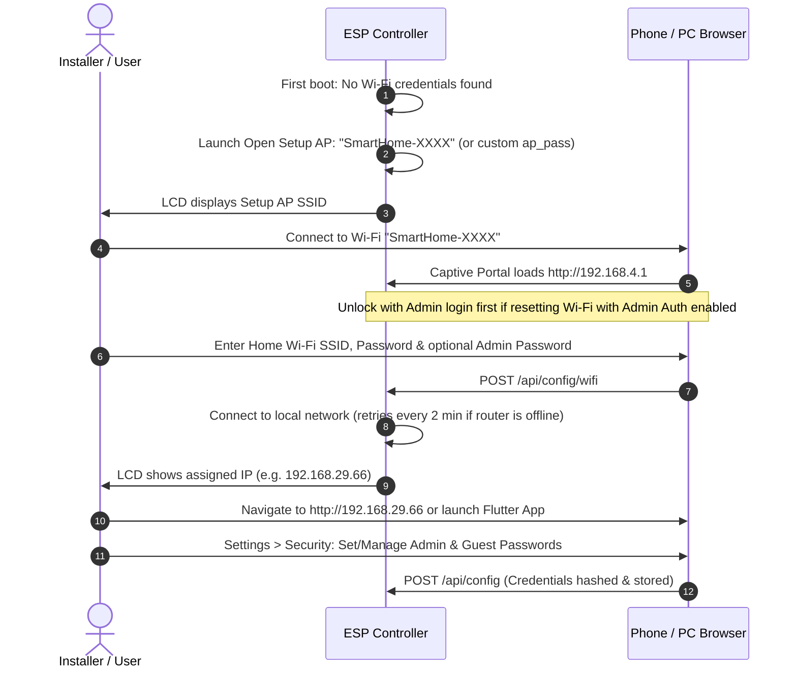

# Smart Home -Smart Environmental Monitoring & Automation System work without Home Assistance

<p align="center">
  
  
  
  
  
  
  
</p>

IoT smart home automation hub powered by a **single unified codebase** that runs seamlessly on both **ESP8266** (NodeMCU, Wemos D1 Mini) and **ESP32** (Dual-Core, DevKit, WROOM), accompanied by a unified cross-platform Flutter companion application (Android, iOS, Windows, macOS). Engineered for 24/7 industrial-level reliability with non-blocking concurrency, zero-brick dual-partition OTA firmware rollback, wear-leveled NVS runtime state storage, multi-user privilege tiers (Admin vs. Family/Guest), dynamic GPIO pin templating, TCP body fragmentation reassembly, and an ultra-modern obsidian glassmorphism web dashboard served directly by each controller.

## 📸 Mobile Application Preview


## 📸 Desktop Application Preview


---

## Table of Contents

1. [Key Features & Pillars](#key-features--pillars)
2. [Dual-Hardware Architecture Matrix (ESP8266 vs. ESP32)](#dual-hardware-architecture-matrix-esp8266-vs-esp32)
3. [System Architecture Diagram](#system-architecture-diagram)
4. [Multi-User Privilege Tiers (Admin vs. Guest)](#multi-user-privilege-tiers-admin-vs-guest)
5. [OTA Firmware Update & Zero-Brick Engine](#ota-firmware-update--zero-brick-engine)
6. [Decoupled NVS State Storage](#decoupled-nvs-state-storage-100000-cycle-endurance)
7. [Hardware & Dynamic GPIO Template Engine](#hardware--dynamic-gpio-template-engine)
8. [Cross-Architecture Backup & Restore Engine](#cross-architecture-backup--restore-engine)
9. [Pre-Compiled Binaries & Release APKs](#pre-compiled-binaries--release-apks)
10. [REST API & WebSocket Specification](#rest-api--websocket-specification)
11. [Flutter Companion App](#flutter-companion-app)
12. [Compilation & Flashing Guide](#compilation--flashing-guide)
13. [First-Time Setup Guide](#first-time-setup-guide)
14. [Troubleshooting](#troubleshooting)
15. [Project Directory Layout](#project-directory-layout)
16. [Sponsor & Support the Project](#sponsor--support-the-project)
17. [License](#license)

---

## Key Features & Pillars

* **Single Unified Codebase**: Runs on both ESP8266 and ESP32 without code branching, conditional hacks, or separate applications.
* **Non-Blocking Asynchronous Core**: Built on asynchronous networking (`ESPAsyncWebServer`, `ESPAsyncTCP` / `AsyncTCP`) and `millis()`-driven state managers without blocking main event loops.
* **TCP Packet Fragmentation Reassembly**: Employs dynamic stream buffering (`collectJsonBody`) across REST JSON endpoints, eliminating `IncompleteInput` or `Invalid JSON` parse errors caused by ESP8266 LWIP TCP MSS packet fragmentation.
* **Zero-Brick Dual-Partition OTA (ESP32)**: Two 1.9MB application partitions (`ota_0`, `ota_1`). If newly flashed firmware boot-loops or panics, the hardware bootloader automatically reverts to the previous working slot within 30 seconds.
* **Seamless Web OTA (ESP8266 & ESP32)**: Intuitive drag-and-drop web updater at `http://<device_ip>/update` allowing 1-click updates over Wi-Fi without needing `esptool.py` or serial cables.
* **Decoupled Wear-Leveled NVS Runtime State**: Rapid relay cycles and switch events are packed into bitmasks and stored in wear-leveled NVS (ESP32) or EEPROM (ESP8266), reserving LittleFS strictly for static JSON configurations and guaranteeing 100,000+ power-cycle endurance.
* **Multi-User Privilege Tiers (Admin vs. Family/Guest)**:
  * **Admin**: Complete system control, GPIO template editing, Wi-Fi credentials, backups, factory reset, and firmware updates.
  * **Family / Guest**: Clean restricted mode allowing switch toggling, sensor monitoring, and quick timers, while locking out hardware changes, network settings, and flashing.
* **Dynamic GPIO Template Engine**: Runtime configuration of relay channels (0 to 8 relays, including relayless Sensor Nodes), pin remapping, boot modes, active-HIGH/LOW polarities, and switch interlocking without reflashing.
* **Obsidian Glassmorphism Web Dashboard**: Single-page application embedded directly in PROGMEM with dark/light themes, SVG iconography, real-time WebSocket telemetry, gauge animations, and a symmetrical 6-card Settings grid.
* **Cross-Platform Flutter Companion App**: Single app controls both ESP8266 and ESP32 units with radar discovery, live WebSocket telemetry, batch multi-device OTA updates, backup management, and encrypted credential storage.
* **About & Sponsorship Screens**: Beautiful modern About page integrated into both the ESP Web Dashboard and the Flutter Companion App with project branding, feature highlights, and direct UPI (India) / PayPal (International) sponsorship support.
* **Home Assistant MQTT Auto-Discovery**: Automatic entity creation for all relays, temperature, humidity, gas sensors, alarms, and diagnostics.
* **Defense-in-Depth Security**: Open SoftAP only for first-time / reset onboarding (no automatic AP fallback when a configured router is offline — controllers retry every 2 minutes instead), optional custom `ap_pass`, IP rate limiting, CSRF header validation, XSS escaping, salted SHA-256 password hashing, sanitized backup exports by default, and encrypted mobile storage.

---

## Dual-Hardware Architecture Matrix (ESP8266 vs. ESP32)

The firmware dynamically detects and adapts to the host silicon at compile-time and runtime:

| Feature | ESP8266 (NodeMCU / D1 Mini / ESP-12) | ESP32 (DevKit / WROOM / Dual-Core) |
| :--- | :--- | :--- |
| **Silicon Architecture** | Tensilica Xtensa L106 @ 80/160 MHz | Tensilica Xtensa Dual-Core LX6 @ 240 MHz |
| **Available RAM / Heap** | ~80 KB (35–45 KB Free Heap) | 520 KB (250–320 KB Free Heap) |
| **Flash Partition Scheme** | 4MB Flash (1MB SPIFFS/LittleFS, 1MB Code) | 4MB Custom Partition (`min_spiffs`: 2x 1.9MB OTA + 192KB LittleFS) |
| **Default Relay Channels** | **2 Channels** (0–8 relays via Custom DIY Mode) | **5 Channels** (0–8 relays via Custom DIY Mode) |
| **Pin Naming** | NodeMCU Pin Names (`D0`–`D8`, `A0`) | Standard GPIO numbers (`GPIO 0`–`39`) |
| **Analog Gas Sensor (MQ-2)** | Dedicated `A0` (10-bit ADC: `0`–`1023`) | Selectable ADC1 channels (12-bit ADC: `0`–`4095`) |
| **Buzzer Acoustic Alert** | Software Non-Blocking PWM Timer | LEDC Hardware PWM Timer Channels |
| **OTA Update Architecture** | Single-Slot Web OTA (`/update`) with safe reboot | Dual-Partition Rollback (`ota_0` / `ota_1`) with 30s stability check |
| **Runtime State Storage** | Wear-leveled EEPROM Bitmasks | Wear-leveled NVS Flash Engine |
| **Hardware Presets** | 2-CH Dual, 1-CH Mini, 3-CH Pro, 4-CH Quad, 8-CH Max, Sensor Node | 5-CH Standard, 1-CH Mini, 2-CH Dual, 4-CH Pro, 8-CH Max, Sensor Node |

---

## System Architecture Diagram

```mermaid
graph TB
    subgraph Firmware_Hub["Unified SmartHome Firmware (v1.1.0)"]
        direction TB
        subgraph Core_Services["Core & Communication Engines"]
            WS_SRV["AsyncWebServer & WebSockets<br/>(Port 80 /ws)"]
            MQTT_CL["AsyncMqttClient<br/>(Home Assistant Discovery)"]
            WIFI_MG["WifiManager<br/>(STA 2-min Retry + Setup AP)"]
            DNS_SRV["Captive Portal & mDNS<br/>(smarthome-XXXX.local)"]
        end

        subgraph Security_Layer["Security & Privilege Engine"]
            AUTH["Multi-Tier RBAC<br/>(Admin vs. Guest / Family)"]
            RATE_L["IP Rate Limiter & Brute-Force Defense"]
            CSRF_G["CSRF Guard & Header Enforcer"]
            SHA_H["Salted SHA-256 Cryptographic Hasher"]
        end

        subgraph Hardware_Controllers["Hardware Subsystem Managers"]
            RELAY_MG["RelayManager<br/>(0-8 Channels + Interlock)"]
            SENSOR_MG["SensorManager<br/>(DHT11/22, BME280/AHT20/SHT3x, BH1750, PIR/LD2410, DS18B20, HC-SR04/JSN-SR04T, MQ-2)"]
            BUZZER_MG["BuzzerManager<br/>(LEDC PWM or ESP8266 PWM)"]
            LCD_MG["LCDManager<br/>(16x2 / 20x4 I2C Auto-Rotation)"]
            TIME_MG["TimeManager<br/>(SNTP + RTC Fallback)"]
            RULE_MG["RuleManager & AlarmScheduler<br/>(Sensor Automation Engine)"]
            BTN_MG["ButtonManager<br/>(Unified Multi-Function Button)"]
            OTA_MG["OTAManager<br/>(Dual-Partition Rollback & Web OTA)"]
        end

        subgraph Storage_Layer["Decoupled Storage Architecture"]
            NVS_PART["Wear-Leveled State Storage<br/>• ESP32 NVS / ESP8266 EEPROM<br/>• Relay Bitmasks & Wall Switch Baselines"]
            FS_PART["LittleFS (Static Filesystem)<br/>• config.json & hardware.json<br/>• rules.json & alarms.json"]
            OTA_PART["Flash Partitions<br/>• Dual OTA Slots (ESP32)<br/>• Safe Web OTA (ESP8266)"]
        end
    end

    subgraph Client_Interfaces["Client Interfaces"]
        WEB_UI["Embedded Obsidian Web Dashboard<br/>(SPA in PROGMEM, WebSocket, REST)"]
        FLUTTER_APP["Unified Flutter Companion App<br/>(Android, iOS, Windows, macOS)"]
        HA_HUB["Home Assistant / Node-RED<br/>(MQTT Auto-Discovery)"]
    end

    Client_Interfaces <==> |REST HTTP & WebSockets| Core_Services
    Core_Services --> Security_Layer
    Security_Layer --> Hardware_Controllers
    Hardware_Controllers --> Storage_Layer
```



---

## Multi-User Privilege Tiers (Admin vs. Guest)

To meet the security demands of commercial installations and multi-tenant homes, authentication is partitioned into distinct privilege tiers:

| Capability / Resource | Administrator Tier | Family / Guest Tier | Unauthenticated |
|:---|:---:|:---:|:---:|
| **Control Relays & Switches** | Full Access | Full Access | Blocked |
| **View Live Sensor Telemetry** | Full Access | Full Access | Blocked |
| **Set Quick Off-Timers** | Full Access | Full Access | Blocked |
| **Mute Alarm Buzzer** | Full Access | Full Access | Blocked |
| **View Logs & Diagnostics** | Full Access | Read-Only (Wi-Fi/MQTT redacted) | Blocked |
| **Hardware & GPIO Template Config** | Full Access | **403 Forbidden** | Blocked |
| **Wi-Fi & Network Configuration** | Full Access | **403 Forbidden** | Blocked |
| **MQTT IoT Broker Settings** | Full Access | **403 Forbidden** | Blocked |
| **System Backup & Restore** | Full Access | **403 Forbidden** | Blocked |
| **OTA Firmware Flashing** | Full Access | **403 Forbidden** | Blocked |
| **Reboot & Factory Reset** | Full Access | **403 Forbidden** | Blocked |
| **mDNS & HTTP Discovery** | Allowed | Allowed | Allowed (`/api/discovery`) |


---

## OTA Firmware Update & Zero-Brick Engine

### 1. Web OTA via Browser (Easiest & Recommended)
Both ESP8266 and ESP32 feature an embedded drag-and-drop Web OTA page:
1. Navigate to: `http://<device_ip>/update`
2. Drop the corresponding `.bin` file from [`binaries/`](binaries/):
   - For ESP8266: `binaries/esp8266/SmartHome_ESP8266.bin`
   - For ESP32: `binaries/esp32/SmartHome_ESP32.bin`
3. Click **"Upload & Flash"**. The controller verifies the binary, flashes, and reboots in ~10 seconds.

### 2. Dual-Partition Zero-Brick Rollback (ESP32)
* Firmware updates write to the inactive application partition (`ota_0` or `ota_1`).
* On first boot, the new image enters `PENDING_VERIFY` state with an armed **30-second stability check**.
* If a crash, panic, or watchdog reset occurs during those 30 seconds, the ESP32 hardware bootloader automatically reverts to the previous working firmware slot without bricking.

---

## Decoupled NVS State Storage (100,000+ Cycle Endurance)

* **Wear-Leveling Mechanism**: Rapid switch toggles and relay activations write only to native wear-leveled NVS (ESP32) or EEPROM (ESP8266).
* **LittleFS Flash Protection**: Static JSON configuration files (`config.json`, `hardware.json`, `rules.json`, `alarms.json`) are only touched when explicitly saving settings from the Web UI or Flutter App.
* **Power-Loss Recovery**: Boot states (`Restore Last`, `Always ON`, `Always OFF`) resolve physical switch baselines before initializing GPIOs, preventing boot chatter or relay flickering on power cycles.

---

## Hardware & Dynamic GPIO Template Engine

The firmware provides a two-mode GPIO Template and Hardware Profile engine accessible via both the **Obsidian Web Dashboard** and the **Flutter Companion App**:

### 1. Two Operational Modes
* **⚡ Smart Presets**: Instant one-click hardware profiles tuned to standard hardware configurations:
  * **ESP8266**: `1-CH Mini`, `2-CH Dual` (Default), `3-CH Pro`, `4-CH Quad`, `8-CH Max`, `Sensor Node` (0 relays).
  * **ESP32**: `1-CH Mini`, `2-CH Dual`, `4-CH Pro`, `5-CH Standard` (Default), `8-CH Max`, `Sensor Node` (0 relays).
* **🛠️ Custom DIY Mode**: Total configuration freedom with zero artificial board or relay limits:
  * **0 to 8 Relays**: Add or remove relay channels dynamically (`+ Add Channel` / `− Remove`) to match your exact hardware.
  * **Custom Wall Switches**: Pair any digital input pin with any relay channel in Toggle, Follow, Inverted Follow, Pushbutton, or Detached mode.
  * **Dynamic Multi-Instance Sensors**: Add or remove multiple sensors per group (`+ Add` / `− Remove` up to hardware GPIO, ADC1/A0, and I2C address availability) across Climate (DHT11/22, BME280, AHT20, SHT3x — up to 4), Light (BH1750 — up to 2), Motion (PIR, LD2410 — up to 6), Water Temp Probe (DS18B20 — up to 4), Ultrasonic Tank Level (HC-SR04P, HC-SR04, JSN-SR04T — up to 4), and Gas (MQ-2 analog/digital — up to 4, keeping ESP8266 `A0` single-analog safe), plus Buzzer, LCD Display, and Status Button.
  * **Shared I2C Bus & 7-Bit Address Arbitration**: Connect multiple I2C devices (LCD1602/2004 `0x27`/`0x3F`, BME280 `0x76`/`0x77`, AHT20 `0x38`, SHT3x `0x44`/`0x45`, BH1750 `0x23`/`0x5C`) simultaneously on the same SDA/SCL bus with automatic next-free address selection and collision blocking.

### 2. Live GPIO Pin Allocation & Capability Matrix
Both Web Dashboard and Companion App include real-time pin capability matrices:
* **Free**: Available for new peripheral assignment (green).
* **In Use**: Shows exact peripheral assignment (e.g., `Relay 1`, `Switch 2`, `I2C SDA`).
* **Boot Strapping Badges**: Identifies boot pins (`GPIO 0, 2, 15` on ESP8266; `GPIO 0, 2, 12, 15` on ESP32) to prevent accidental pull-down/pull-up startup hangs.
* **Input-Only Protection**: Blocks input-only pins (ESP32 `GPIO 34–39`, ESP8266 `A0 / GPIO 17`) from being assigned to outputs (relays, buzzer, DHT data line, ultrasonic trig).
* **Real-Time Conflict Detection**: Highlights double-assignments in red with interactive resolution guidance before applying.

### Default Pin Configurations

#### ESP8266 Standard 2-CH Dual (NodeMCU)
| Peripheral | NodeMCU Pin | GPIO Number | Function / Notes |
|:---|:---:|:---:|:---|
| **Relay 1 Output** | `D6` | GPIO 12 | Active LOW trigger |
| **Relay 2 Output** | `D5` | GPIO 14 | Active LOW trigger |
| **Wall Switch 1** | `D7` | GPIO 13 | Toggle Rocker (Internal Pull-Up) |
| **Wall Switch 2** | `D0` | GPIO 16 | Toggle Rocker (External Pull-Up) |
| **Climate Sensor** | `—` | Disabled (`255`) | Add I2C (`BME280`/`AHT20`/`SHT3x`) on shared `D2`/`D1` or 1-Wire DHT in Custom DIY |
| **I2C SDA (LCD / Sensors)** | `D2` | GPIO 4 | Shared I2C Bus |
| **I2C SCL (LCD / Sensors)** | `D1` | GPIO 5 | Shared I2C Bus |
| **Acoustic Buzzer** | `D4` | GPIO 2 | Software PWM / Active LOW |
| **Gas Sensor (MQ-2)** | `A0` | ADC0 / GPIO 17 | Disabled by default — Analog Gas Reading (`0`–`1023`), enable in Hardware Config |
| **Multi-Button** | `D3` | GPIO 0 | Pull-up Button / AP Reset |

#### ESP32 Standard 5-CH Profile
| Peripheral | GPIO Number | Function / Notes |
|:---|:---:|:---:|
| **Relays 1 – 5 Outputs** | GPIO 16, 17, 18, 19, 23 | Active LOW triggers |
| **Wall Switches 1 – 5** | GPIO 13, 14, 27, 26, 25 | Toggle Rocker Inputs |
| **Climate Sensor (DHT22)** | GPIO 4 | Bidirectional 1-Wire |
| **I2C SDA & SCL** | GPIO 21 (SDA), GPIO 22 (SCL) | LCD1602 & I2C Sensors |
| **Gas Sensor (MQ-2)** | GPIO 34 (Analog), GPIO 35 (Digital) | Disabled by default — ADC1 (`0`–`4095`), enable in Hardware Config |
| **Acoustic Alarm Buzzer** | GPIO 5 | LEDC Hardware PWM Channel |
| **Multi-Function Button** | GPIO 33 | Multi-function button |

---

## Cross-Architecture Backup & Restore Engine

The backup & restore subsystem guarantees complete data preservation and cross-architecture safety:

* **Architecture Conflict Protection**: Backups include metadata tags (`"_chip": "ESP8266"` or `"ESP32"`). If an ESP32 backup is restored onto an ESP8266, the engine safely detects the incompatible pin layout, preserves the valid ESP8266 hardware profile, and applies all device configurations (Wi-Fi networks, MQTT credentials, relay names, timers, alarms, rules, and LCD modes).
* **Compact Serialization**: Employs minified JSON serialization during export, reducing payload size by over **50%** (from ~7 KB to ~3 KB) to guarantee zero heap fragmentation on ESP8266.
* **TCP Multi-Chunk Assembly**: Restores sent via Web UI or Mobile App are buffered across fragmented packets and capped at 32 KB to prevent memory overflow.

---

## Pre-Compiled Binaries & Release APKs

All pre-compiled firmware binaries and mobile application packages are included directly in [`binaries/`](binaries/):

### 1. Embedded Firmware Binaries
| Board | File Path | Usage |
|:---|:---|:---|
| **ESP8266** | [`binaries/esp8266/SmartHome_ESP8266.bin`](binaries/esp8266/SmartHome_ESP8266.bin) | Web OTA update via `http://<ip>/update` (956 KB) |
| **ESP32** | [`binaries/esp32/SmartHome_ESP32.bin`](binaries/esp32/SmartHome_ESP32.bin) | Web OTA update via `http://<ip>/update` (1.82 MB) |
| **ESP32 (Full Flash)** | [`binaries/esp32/SmartHome_ESP32_merged_0x0.bin`](binaries/esp32/SmartHome_ESP32_merged_0x0.bin) | Serial flasher at offset `0x0` (4.00 MB) |

### 2. Flutter Companion App Release APKs
| Target Architecture | File Path | Size | Device Compatibility |
|:---|:---|:---:|:---|
| **ARM 64-bit** | [`binaries/app/app-arm64-v8a-release.apk`](binaries/app/app-arm64-v8a-release.apk) | **20.7 MB** | **All modern Android phones** (Samsung, Pixel, OnePlus, Xiaomi) |
| **ARM 32-bit** | [`binaries/app/app-armeabi-v7a-release.apk`](binaries/app/app-armeabi-v7a-release.apk) | **18.3 MB** | Older 32-bit Android phones |
| **x86_64** | [`binaries/app/app-x86_64-release.apk`](binaries/app/app-x86_64-release.apk) | **22.2 MB** | Android Emulators & ChromeOS |

---

## REST API & WebSocket Specification

### Core Endpoints

| Method | Endpoint | Access Tier | Description |
|:---|:---|:---:|:---|
| `GET` | `/api/status` | Family / Admin | Real-time sensor telemetry, relay states, system heap & uptime |
| `GET` | `/api/discovery` | Public | Lightweight discovery payload (`auth_required`, MAC, model, relays) |
| `POST` | `/api/relay` | Family / Admin | Toggle or set individual relay (`{"id": 0, "action": "toggle"}`) |
| `POST` | `/api/relay/all` | Family / Admin | Bulk control (`{"action": "on"}` or `{"action": "off"}`) |
| `POST` | `/api/relay/timer` | Family / Admin | Set quick off/on timer (`{"id": 0, "duration": 1800}`) |
| `POST` | `/api/config` | Admin | Update system parameters (Device Name, Timezone, Passwords) |
| `POST` | `/api/config/wifi` | Admin (or Fresh Setup) | Save Wi-Fi STA credentials & connect |
| `POST` | `/api/config/mqtt` | Admin | Configure Home Assistant MQTT IoT broker |
| `POST` | `/api/hardware` | Admin | Save dynamic GPIO pin mapping template |
| `GET` | `/api/backup` | Admin | Export sanitized system configuration JSON (`?sanitize=0` for full secrets) |
| `POST` | `/api/restore` | Admin | Restore system configuration JSON & reboot |
| `POST` | `/api/reboot` | Admin | Gracefully reboot controller |
| `POST` | `/api/factory-reset`| Admin | Delete LittleFS configs & revert to factory defaults |
| `GET` | `/api/logout` | Family / Admin | Invalidate session, evict browser HTTP auth headers |
| `WS` | `/ws` | Family / Admin | Real-time bi-directional telemetry broadcast socket |

---

## Flutter Companion App

The Flutter companion app (`app/`) provides unified control over all ESP8266 and ESP32 controllers on your local network:

* **Radar Discovery**: Automatically detects online controllers via mDNS (`_smarthome._tcp`) and intelligent subnet probing (`/api/discovery`) without manual IP configuration. Displays Amber badges for ESP8266 and Cyan badges for ESP32.
* **Architecture-Aware Hardware Editor**: Adapts pin dropdowns and preset templates dynamically based on whether the selected controller is ESP8266 or ESP32.
* **Safe-by-Default Firmware OTA**: Defaults to single-controller OTA with binary header + chip-ID validation to prevent cross-flashing ESP32 and ESP8266 images, plus an opt-in same-chip batch mode when 2+ identical controllers are online.
* **Hub Migration**: One-click export of all paired controllers, room assignments, credentials, and custom icon sets in a single `.json` file.

### Running the App Locally:
```bash
cd app/
flutter pub get

# Run on connected smartphone or emulator:
flutter run

# Run automated test suite:
flutter test

# Build release APKs:
flutter build apk --obfuscate --split-debug-info=build/app/outputs/symbols --split-per-abi --no-tree-shake-icons
```

---

## Compilation & Flashing Guide

### Automated 1-Click Build Script (Recommended)

The project includes an automated PowerShell build script [`build_firmware.ps1`](build_firmware.ps1) that compiles firmware and copies output binaries to `binaries/`:

```powershell
# Build for both ESP8266 and ESP32:
.\build_firmware.ps1

# Build for a specific target only:
.\build_firmware.ps1 -Target esp32
.\build_firmware.ps1 -Target esp8266
```

The script auto-detects the locally installed `arduino-cli`, compiles with the correct FQBN and partition scheme, and copies the resulting `.bin` files to `binaries/esp8266/` and `binaries/esp32/`.

### Manual Compilation via Arduino CLI

#### 1. For ESP8266 (NodeMCUv2 / 4MB):
```bash
arduino-cli compile --fqbn esp8266:esp8266:nodemcuv2 SmartHome.ino
```

#### 2. For ESP32 (4MB Flash with Dual OTA):
```bash
arduino-cli compile --fqbn espressif:esp32:esp32:PartitionScheme=min_spiffs SmartHome.ino
```

---

## First-Time Setup Guide



1. **Power On**: Power the controller via 5V/2A power supply.
2. **Join Hotspot**: Connect your smartphone or PC to `SmartHome-XXXX`. On a fresh flash or factory/Wi-Fi reset, the setup hotspot is **Open** (no password required—ideal for headless controllers without an LCD) unless you explicitly configure a custom `"ap_pass"`. Once Wi-Fi is configured, controllers never fall back to AP mode if your router goes offline; they retry connecting every 2 minutes until the router returns or you manually reset Wi-Fi via the physical button.
3. **Captive Portal**: Tap the *"Sign in to Wi-Fi network"* notification (or open `http://192.168.4.1`) and connect the controller to your home Wi-Fi network. If you performed a Wi-Fi-only reset with Admin Auth already enabled, enter your existing Admin credentials inline on the setup screen to unlock Wi-Fi scanning and saving.
4. **Access Dashboard**: Open `http://<device_ip>` or launch the Flutter companion app.
5. **Set Passwords**: Go to **Settings > Security & Privilege Tiers** and set your **Admin** and **Guest** passwords.

---

## Troubleshooting

### "Invalid JSON" error when saving settings on ESP8266
This was caused by TCP MSS body fragmentation in older builds. Flash the latest firmware binary ([`binaries/esp8266/SmartHome_ESP8266.bin`](binaries/esp8266/SmartHome_ESP8266.bin)) via `/update` which reassembles fragmented TCP packets seamlessly.

### Captive portal does not open automatically
If your phone previously connected to `SmartHome-XXXX` and dismissed the prompt (or tapped *"Use network anyway"*), tap **Forget** on `SmartHome-XXXX` in your phone's Wi-Fi settings and reconnect, or manually navigate to `http://192.168.4.1` in your browser while connected to the controller's Wi-Fi access point.

### Serial flasher fails with "Flash ID: 0" on ESP8266
On ESP8266, GPIO 0, 2, and 15 are hardware strapping pins. If attached peripherals pull these pins during serial flashing, bootloader handshake fails. **Use Web OTA (`http://<device_ip>/update`) instead**, which completely bypasses all serial pin strapping restrictions.

### Physical Multi-Button Functions (GPIO 33 / GPIO 0)
* **Hold 6–10 seconds**: Triggers a **Wi-Fi Reset** (clears saved Wi-Fi credentials and enters AP setup mode without losing relay or auth configs).
* **Hold 10–14 seconds**: Triggers a **Full Factory Reset** (wipes LittleFS configs & NVS state and reboots to factory defaults).

---

## Project Directory Layout

```text
SmartHome/
├── SmartHome.ino                  # Main Arduino firmware setup and main loop
├── Config.h                       # Global configuration constants and dual-chip pin definitions
├── WebPages.h                     # Embedded obsidian glassmorphism SPA dashboard in PROGMEM
├── WebServerManager.h / .cpp      # REST API endpoints, RBAC tiers, TCP reassembly, rate limiter
├── WebSocketManager.h / .cpp      # Real-time WebSocket event broadcaster
├── RelayManager.h / .cpp          # Multi-channel relay control, polarity, quick timers
├── SensorManager.h / .cpp         # DHT11/22, BME280/AHT20/SHT3x, BH1750, PIR/LD2410, DS18B20, HC-SR04/JSN-SR04T, MQ-2
├── HardwareManager.h / .cpp       # Dynamic GPIO template manager and pin safety catalogs
├── StorageManager.h / .cpp        # Decoupled wear-leveled NVS & LittleFS storage
├── OTAManager.h / .cpp            # Zero-brick dual-partition rollback and Web OTA manager
├── WifiManager.h / .cpp           # Multi-AP Wi-Fi manager and captive portal
├── MqttManager.h / .cpp           # Home Assistant MQTT auto-discovery client
├── LCDManager.h / .cpp            # 16x2 / 20x4 I2C LCD screen auto-rotation and alert display
├── BuzzerManager.h / .cpp         # Acoustic alert patterns (LEDC PWM on ESP32, PWM on ESP8266)
├── ButtonManager.h / .cpp         # Multi-function button hardware debounce handler
├── EventLogger.h / .cpp           # Circular memory-buffered diagnostic event logger
├── Diagnostics.h / .cpp           # Hardware health, heap tracking, silicon diagnostics
├── TimeManager.h / .cpp           # SNTP network clock and DS3231 RTC fallback
├── AlarmScheduler.h / .cpp        # Scheduled calendar and delay event manager
├── RuleManager.h / .cpp           # Condition-action sensor automation engine
├── RemoteAlertManager.h / .cpp    # Async remote webhook & ntfy push alerts
├── build_firmware.ps1             # Automated 1-click firmware build script (ESP8266 + ESP32)
├── CHANGELOG.md                   # Release notes and version history
├── asset/                         # Project icon and branding assets
├── binaries/                      # Ready-to-flash binaries & release APKs
│   ├── esp8266/                   # Compiled SmartHome_ESP8266.bin & SmartHome.ino.bin for Web OTA
│   ├── esp32/                     # Compiled SmartHome_ESP32.bin, bootloader, partitions & merged 0x0 binary
│   └── app/                       # Release APKs (arm64-v8a, armeabi-v7a, x86_64)
└── app/                           # Flutter cross-platform companion app
    ├── pubspec.yaml               # Flutter dependencies and assets
    ├── lib/                       # Dart application source code
    │   └── presentation/screens/
    │       └── about_screen.dart  # About & Sponsorship screen (UPI + PayPal)
    └── test/                      # Automated unit and widget test suite (120 tests)
```

---

## Sponsor & Support the Project

If it brings value to your home or maker setups, consider sponsoring to fuel ongoing firmware development, hardware lab testing, and new features!

### 🇮🇳 India — UPI Payment (Zero Fee · Instant)

| UPI VPA ID | Supported Apps |
|:---|:---|
| **`1vikash@ybl`** | Google Pay · PhonePe · Paytm · BHIM · Cred · Amazon Pay |

### 🌍 International — PayPal

| PayPal | Link |
|:---|:---|
| **Vikash Choudhary** | [https://paypal.me/1vikash](https://paypal.me/1vikash) |


## License

Copyright © 2026 Vikash Choudhary. All rights reserved.

This project is released under the **[Personal Non-Commercial Source-Available License](LICENSE)**:
- **Permitted**: Free personal, private, non-commercial home use on your own hardware.
- **Prohibited**: Any code modification, derivative works, redistribution, or commercial/business use.
- **No Warranty**: Provided `"AS IS"` without warranty or liability of any kind. See [`LICENSE`](LICENSE) for full terms.
